# Tutorial 1A: Automatic Machine Learning Introduction with Driverless AI

## Overview 

- This tutorial explores the Titanic dataset from the perspective of a passenger life insurance company while using and learning about H2O.ai's enterprise product, Driverless AI. We will explore possible risk factors derived from this dataset that could have been considered when selling passenger insurances. More specifically, we will create a predictive model to determine what factors contributed to a passenger surviving.

- Alongside the core analysis, you'll gain hands-on experience with Driverless AI. We'll cover essential functions like data loading, exploration of data details, generate Auto visualizations, experiment setup, explore feature engineering, and result interpretation through the Machine Learning Interpretability report.

- By the end, you'll have a good grasp of both Driverless AI's capabilities and the factors influencing passenger survival on the Titanic, all from the perspective of a life insurance company.

## Prerequisites

- Basic knowledge of Machine Learning and Statistics

- A Two-Hour Test Drive session: Test Drive is H2O.ai's Driverless AI on the AWS Cloud. No need to download software. Explore all the features and benefits of the H2O Automatic Learning Platform.
> - Need a Two-Hour Test Drive session? Follow the instructions [on this quick self-paced course](https://h2oai.github.io/tutorials/getting-started-with-driverless-ai-test-drive/#0) to get a Test Drive session started. After the Driverless AI Test Drive session starts, continue reading the remaining prerequisites of this self-paced course, then start Task 1: Product Tour.
> - Already have a Two-Hour Test Drive session? Proceed to [Task 1: Product Tour](#task-1-product-tour)

## Task 1: Product Tour

### Overview
H2O Driverless AI is an artificial intelligence(AI) platform for automatic machine learning. Driverless AI automates some of the most difficult data science and machine learning workflows such as feature engineering, model validation, model tuning, model selection, and model deployment. It aims to achieve highest predictive accuracy, comparable to expert data scientists, but in much shorter time thanks to end-to-end automation. Driverless AI also offers automatic visualizations and machine learning interpretability(MLI). Especially in regulated industries, model transparency and explanation are just as important as predictive performance. Modeling pipelines (feature engineering and models) are exported (in full fidelity, without approximations) both as Python modules and as pure Java standalone scoring artifacts.

### Why Driverless AI?
Over the last several years, machine learning has become an integral part of many organizations' decision-making process at various levels. With not enough data scientists to fill the increasing demand for data-driven business processes, H2O.ai offers Driverless AI, which automates several time consuming aspects of a typical data science workflow, including data visualization, feature engineering, predictive modeling, and model explanation.

H2O Driverless AI is a high-performance, GPU-enabled computing platform for automatic development and rapid deployment of state-of-the-art predictive analytics models. It reads tabular data from plain text sources, Hadoop, or S3 buckets and automates data visualization and building predictive models. Driverless AI targets business applications such as loss-given-default, probability of default, customer churn, campaign response, fraud detection, anti-money-laundering, demand forecasting, and predictive asset maintenance models. (Or in machine learning parlance: common regression, binomial classification, and multinomial classification problems).

### Tour

Welcome to the Driverless AI **Datasets** page (this will be the first thing you will see when you click your **Driverless AI URL**): 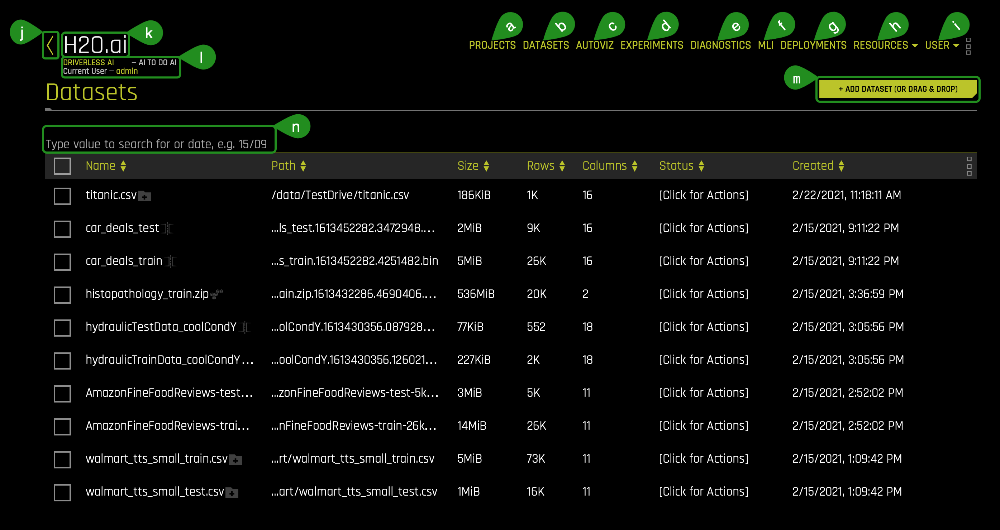

On the **Datasets** page, the following options and features can be found. Now, we will quickly review them, but we will further explore these options and features before and after we launch an experiment in the upcoming tasks.

:::info note 
1.  In the **Projects** section, you can manage your datasets and experiments related to a specific business problem or use case.
2. In the **Datasets** section, you can view current datasets that have been added. Other dataset features include the option to get dataset details, visualize, split, predict, rename, download, and delete.
3. **Autoviz** shows graphs explaining the selected dataset to visualize. Note that the graphs on the visualization page can vary based on the information in your dataset. You can also view and download logs that Driverless AI generated during the visualization.
4. In the **Experiments** section, you can view completed experiments. Experiments can be revised or deleted.
5. In the **Diagnostics** section, you can diagnose a model and view model performance for multiple scorers based on the existing model and dataset.
6. In the **MLI (Machine Learning Interpretability)** section, you can interpret a model and view a list of already interpreted models.
7. The **Deployments** section allows you to access the MOJO and Python scoring pipelines for you to test or integrate into a final product. You can also deploy locally or in the cloud.

The <b>Resources</b> dropdown menu provides you with the following options to view or download:

- System Info
- Python Client
- R Client
- MOJO2 Java Runtime
- MOJO2 Py Runtime
- MOJO 2 R Runtime
- Tutorials
- Help
- About

The <b>User</b> option offers the following options:

- <b>Messages[ ]</b>: View upcoming events regardinging Driverless AI.
- <b>Logout</b>: Logs you out of your current session.

8. **<:** Takes you back to the previous page
9. **H2O.ai**: Takes you back to the H2OAI **Datasets** page.
10. **Driverless AI 1.X.X**: Version of Driverless AI

The <b>+ Add a Dataset(or Drag and Drop)</b> button provides the following options:

- <i>File System</i>: Search for datasets in our repository
- <i>Upload File</i>: Upload a dataset from your computer
- <i>Amazon S3</i>: Upload a dataset by using S3 buckets
- <i>Hadoop File System</i>: Upload a dataset from Hadoop
- <i>Data Recipe URL</i>: Upload a dataset with a customize data recipe reachable through a URL
- <i>Upload Data Recipe</i>: Upload a dataset with a customize data recipe located on your computer

11. **Type value to search for or date, e,g,** 15⁄09: Search for a given dataset by inputting its creation date.
:::

Before we load the dataset for our experiment, let us review some introductory concepts around Machine Learning.
#### Deeper Dive and Resources
- Learn more about H2O Driverless through the [H2O documentation](http://docs.h2o.ai/driverless-ai/latest-stable/docs/booklets/DriverlessAIBooklet.pdf).
- [Explore H2O Product Documentation](http://docs.h2o.ai/)
- [Learn more H2O Driverless by reviewing the FAQs](http://docs.h2o.ai/driverless-ai/latest-stable/docs/userguide/faq.html)

## Task 2: Automatic Machine Learning Concepts
### Artificial Intelligence and Machine Learning
The concepts found in this task are meant to provide a high-level overview of Machine Learning. At the end of this task, you can find links to resources that offer a more in-depth explanation of the concepts covered here.

Machine learning is a subset of Artificial intelligence where the focus is to create machines that can simulate human intelligence. One critical distinction between artificial intelligence and machine learning is that machine learning models "learn" from the data the models get exposed to. Arthur Samuel, a machine learning pioneer back in 1959, defined machine learning as a " field of study that gives computers the ability to learn without being explicitly programmed" [1]. A machine learning algorithm trains on a dataset to make predictions. These predictions are, at times, used to optimize a system or assist with decision-making.

### Machine Learning Training
Advances in technology have made it easier for data to be collected and made available. The available type of data will determine the kind of training that the machine learning model can undergo. There are two types of machine learning training, supervised and unsupervised learning. Supervised learning is when the dataset contains the output that you are trying to predict. For those cases where the predicting variable is not present, it's called unsupervised learning. Both types of training define the relationship between input and output variables.

In machine learning, the input variables are called features and the output variables labels. The labels, in this case, are what we are trying to predict. The goal is to take the inputs/variables/features and use them to come up with predictions on never-before-seen data. In linear regression, the features are the x-variables, and the labels are the y-variables. An example of a label could be the future price of avocados. In terms of feature examples regarding this self-paced course, in Task 3, we will see the following features when creating our survival prediction model: passenger class, sex, age, passenger fare, cabin number, etc.

A machine learning model defines the relationship between features and labels. Anyone can train a model by feeding it examples of particular instances of data. You can have two types of examples: labeled and unlabeled. Labeled examples are those where the X and Y values (features, labels) are known. Unlabeled examples are those where we know the X value, but we don't know the Y value[1]. Your dataset is similar to an example; the columns that will be used for training are the features; the rows are the instances of those features. The column that you want to predict is the label.

Supervised learning takes labeled examples and allows a model that is being trained to learn the relationship between features and labels. The trained model can then be used on unlabelled data to predict the missing Y value. The model can be tested with either labeled or unlabeled data. Note that H2O Driverless AI creates models with labeled examples.

### Data Preparation
A machine learning model is as good as the data that is used to train it. If you use garbage data to train your model, you will get a garbage model. With that said, before uploading a dataset into tools that will assist you with building your machine learning model, such as Driverless AI, ensure that the dataset has been cleaned and prepared for training. Transforming raw data into another format, which is more appropriate and valuable for analytics, is called data wrangling.

Data wrangling can include extractions, parsing, joining, standardizing, augmenting, cleansing, and consolidating until the missing data is fixed or removed. Data preparation includes the dataset being in the correct format for what you are trying to do; accordingly, duplicates are removed, missing data is fixed or removed, and finally, categorical values are transformed or encoded to a numerical type. Tools like [Python datatable](https://datatable.readthedocs.io/en/latest/?badge=latest), [Pandas](https://pandas.pydata.org/) and [R](https://www.r-project.org/) are great assets for data wrangling.

Data wrangling can be done in Driverless AI via a [data recipe](https://www.r-project.org/), the [JDBC connector](http://docs.h2o.ai/driverless-ai/1-8-lts/docs/userguide/connectors-nd/jdbc.html?highlight=jdbc) or through [live code](http://docs.h2o.ai/driverless-ai/1-8-lts/docs/userguide/datasets-describing.html?highlight=live%20code#modify-by-recipe) which will create a new dataset by modifying the existing one.

### Data Transformation/Feature Engineering
Data transformation or feature engineering is the process of creating new features from the existing ones. Proper data transformations on a dataset can include scaling, decomposition, and aggregation [2]. Some data transformations include looking at all the features and identifying which features can be combined to make new ones that will be more useful to the model's performance. For categorical features, the recommendation is for classes that have few observations to be grouped to reduce the likelihood of the model overfitting. Categorical features may be converted to numerical representations since many algorithms cannot handle categorical features directly. Besides, data transformation removes features that are not used or are redundant[3]. These are only a few suggestions when approaching feature engineering. Feature engineering is very time-consuming due to its repetitive nature; it can also be costly. After successfully or having a notion of well-done data transformation, the next step in creating a model is selecting an algorithm.

### Algorithm Selection
"Machine learning algorithms are described as learning a target function (f) that best maps input variables (x) to an output variable(y): Y= f(x)" [4]. In supervised learning, there are many algorithms to select from for training. The type of algorithm(s) will depend on the size of your data set, structure, and the type of problem you are trying to solve. Through trial and error, the best performing algorithms can be found for your dataset. Some of those algorithms include linear regression, regression trees, random forests, Naive Bayes, and boosting, to name a few [5].

### Model Training
#### Datasets
When training a machine learning model, one good practice is to split up your dataset into subsets: training, validation, and testing sets. A good ratio for the entire dataset is 70-15-15, 70% of the whole dataset for training, 15% for validation, and the remaining 15% for testing. The **training set** is the data used to train the model, and it needs to be big enough to get significant results from it. The **validation set** is the data held back from the training and will be used to evaluate and adjust the trained model's hyperparameters and, hence, adjust the performance. Finally, the **test set** is data that has also been held back and will be used to confirm the final model's results [1].

:::info note 
The validation dataset is used for tuning the modeling pipeline. If provided, the entire training data will be used for training, and validation of the modeling pipeline is performed with only this validation dataset. When you do not include a validation dataset, Driverless AI will do K-fold cross-validation for I.I.D. (identically and independently distributed) experiments and multiple rolling window validation splits for time series experiments. For this reason, it is not generally recommended to include a validation dataset as you are then validating on only a single dataset. Please note that time series experiments cannot be used with a validation dataset: including a validation dataset will disable the ability to select a time column and vice versa.
:::

This dataset must have the same number of columns (and column types) as the training dataset. Also, note that if provided, the validation set is not sampled down, so it can lead to large memory usage, even if accuracy=1 (which reduces the train size). In a moment, we will learn more about accuracy when preparing an experiment.[10] 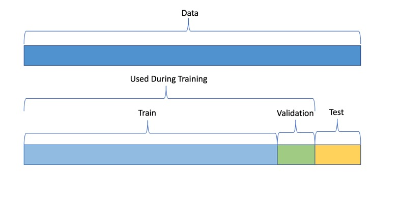

Another part of model training is fitting and tuning the models. For fitting and tuning, hyperparameters need to be tuned, and cross-validation needs to take place using only the training data. Various hyperparameter values will need to be tested. "A hyperparameter is a parameter that is set before the learning process begins. These parameters are tunable and can directly affect how well a model trains. [In Machine Learning, a hyperparameter is the learning rate]" [7]. In other words, the hyperparameter value is used to determine the rate at which the model learns.

With cross-validation, the whole dataset is utilized, and each model is trained on a different subset of the training data [8]. Additionally, a cross-validation loop will be set to calculate the cross-validation score for each set of hyperparameters for each algorithm. Based on the cross-validation score and hyperparameter values, you can select the model for each algorithm that has been tuned with training data and tested with your test set. Remember that "a model in [Machine Learning(ML)] is the output of an ML algorithm run on data. It represents what was learned by a machine learning algorithm." [9]

### What are the challenges in AI Model Development?
One of the significant challenges in developing a single production-ready model is that it can take weeks or months to build it. Developing a model involves feature engineering, model building, and model deployment. All tasks are very repetitive, time-consuming, require advanced knowledge of feature generation, algorithms, parameters, and model deployment. Finally, there needs to be in-depth knowledge and confidence in how the model was generated to justify how it made its decisions.

### What is Automated Machine Learning, and why is it important?
AutoML or Automated Machine Learning is the process of automating algorithm selection, feature generation, hyperparameter tuning, iterative modeling, and model assessment. AutoML tools such as H2O Driverless AI makes it easy to train and evaluate machine learning models. Automating the repetitive tasks around Machine Learning development allows individuals to focus on the data and the business problems they are trying to solve.

With this task in mind, let's explore and load the data that we will be using when predicting whether a passenger would've survived the titanic accident.

### References
- [1]: [Google's Machine Learning Crash Course](https://developers.google.com/machine-learning/crash-course/training-and-test-sets/splitting-data)
- [2]: [About Train, Validation and Test Sets in Machine Learning](https://towardsdatascience.com/train-validation-and-test-sets-72cb40cba9e7)
- [3]: [Data Science Primer - Data Cleaning](https://elitedatascience.com/data-cleaning)
- [4]: [Feature Engineering](https://elitedatascience.com/feature-engineering)
- [5]: [Towards Data Science- Supervised vs Unsupervised Learning](https://towardsdatascience.com/supervised-vs-unsupervised-learning-14f68e32ea8d)
- [6]: [Selecting the best Machine Learning Algorithm for your regression problem](https://towardsdatascience.com/selecting-the-best-machine-learning-algorithm-for-your-regression-problem-20c330bad4ef)
- [7]: [Deep AI - What is a hyperparameter?](https://deepai.org/machine-learning-glossary-and-terms/hyperparameter)
- [8]: [H2O.ai's Driverless AI - Internal Validation Technique](http://docs.h2o.ai/driverless-ai/1-8-lts/docs/userguide/internal-validation.html?highlight=cross%20validation)
- [10]: [Validation Dataset](http://docs.h2o.ai/driverless-ai/latest-stable/docs/userguide/experiment-settings.html#validation-dataset)

### Deeper Dive and Resources
- [Explore the replays from H2O World Around the World](https://www.h2o.ai/h2oworldnewyork/)
- [Explore the Webinar Replays](https://www.brighttalk.com/search/?q=driverless+ai)
- [Explore the various H2O Driverless AI playlists on YouTube](https://www.youtube.com/user/0xdata/playlists)

## Task 3: Load Data
### What is the Driverless AI Workflow?
The typical Driverless AI workflow is to:

1. Load data
2. Visualize data
3. Run an experiment
4. Interpret the model
5. Deploy the scoring pipeline

Besides, you can diagnose a model, transform another dataset, score the model against another dataset and manage your data in Projects. This self-paced course's focus will be on steps 1 - 4. We will cover Driverless AI's other aspects in other self-paced courses found in the Driverless AI learning path. We will start with step 1: load data. 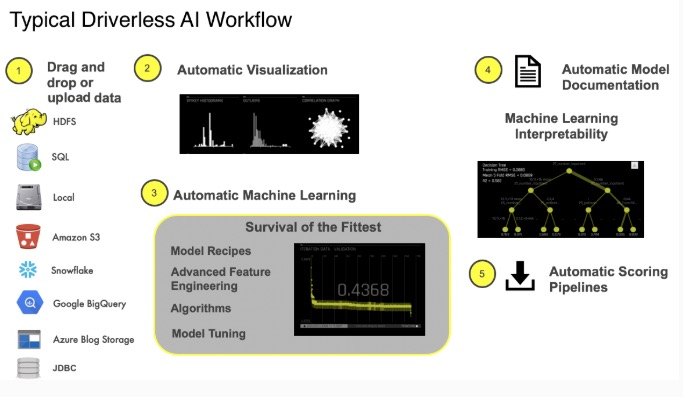

### About the Dataset
The dataset used for this experiment is a version of the Titanic Kaggle dataset. This dataset contains the list of estimated passengers aboard the RMS Titanic.

The RMS Titanic was a British commercial passenger liner that sank after colliding with an iceberg in the North Atlantic Ocean on April 15, 1912. More than 1,500 people lost their lives from an estimated 2,224 passengers and crew members while on their way to New York City from Southampton.

This tragedy shocked the international community and led to better safety regulations for ships. The lack of lifeboats, amongst other things, was one of the factors that resulted in a significant loss of life. Although there was some element of luck involved in surviving the sinking, some groups of people were more likely to survive than others. 

 Figure 1. RMS Titanic 

To further understand the data, please consider the table below:

| Attribute| Definition      | Key |
| :------------------  | :-------------------| :----------|
| `passenger Id`    |    Id randomly generated   | - |
| `pclass`    |  Passenger Class     | Type of notebook|
| `survived`    |   Survival   |0=No, 1=Yes|
| `name_with_salutations`    |    Passenger name   | -|
| `name_without_salutations`    |  Passenger name without salutations     |-|
| `sex`    |   Sex   |Female, Male|
| `age`    |    Age in years   | -|
| `sibsp`    |  Number of siblings/Spouse aboard     | -|
| `parch`    |   Number of Parents/Children aboard   |-|
| `ticket`    |  Ticket number     | -|
| `fare`    |  Passenger fare     | -|
| `cabin`    |  Cabin number   |-|
| `embarked`    |   Port of Embarkment   |C = Cherbourg, Q = Queenstown, S = Southampton|
| `boat`    |   Boat number   |-|
| `body`    |   Body number   |-|
| `home.des`    |   Home Destination   |-|

### Add the Dataset
1. Navigate back to the H2O Driverless AI Datasets page. To add the dataset: 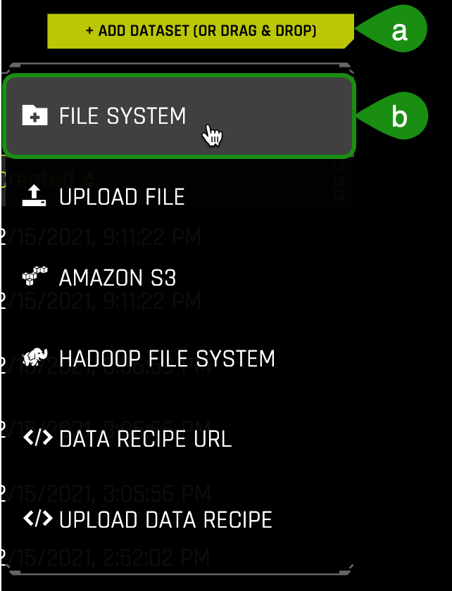

a. Click on **Add a Dataset(or Drag and Drop)**

b. Select **FILE SYSTEM**:

2. Inside the FILE SYSTEM:
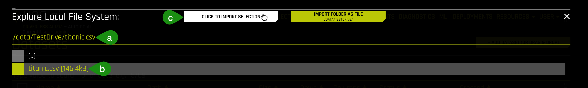

a. Enter the following in the search bar:`/data/TestDrive/titanic.csv`

b. Select the `titanic.csv`

c. Click to **Import Selection**:

3. The following will appear after you have successfully imported the dataset: 
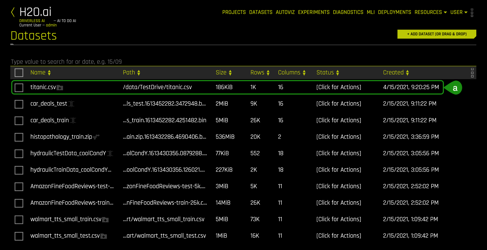

:::info note
a. You can view:
- File name
- File path
- File size
- Number of rows/columns
- File status
- Date created
:::

Now that the dataset has been imported let's discover on the next task how Driverless AI allows users to further understand a selected dataset. Doing so will allow us to further explore the second step of the Driverless AI workflow: visualize data.

### Deeper Dive and Resources
- [Learn More About the Type of Dataset File Formats that can be Uploaded](http://docs.h2o.ai/driverless-ai/latest-stable/docs/userguide/datasets.html#adding-datasets).
- For more datasets, check out [Kaggle Datasets](https://www.kaggle.com/datasets).

## Task 4: Explore Data Details and AutoViz
### Details
We are now going to explore the Titanic dataset that we just loaded.

1. On the Dataset Overview page, click on the titanic.csv. The following options will appear:
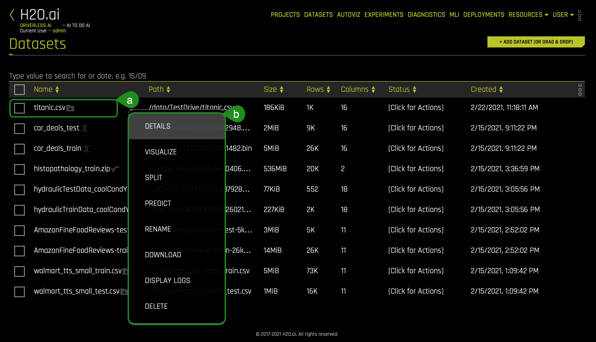

:::info note
**a**. The dataset we imported in task 3

**b**. Options:
- **Details** - View a summary of the dataset or preview the dataset
- **Visualize** - Visualize the dataset with available graphs
- **Split** - Split the dataset
- **Predict** - Run an experiment using Driverless AI
- **Rename** - Rename the dataset
- **Download** - Download the dataset
- **Display Logs** - Dataset logs
- **Delete** - Delete the dataset

A dataset can only be deleted if it's not being used in an experiment. Otherwise, you must delete the experiment first, and then the dataset.
:::

Next, we are going to confirm that the dataset loaded correctly and that it has the correct number of rows and columns.

2. Click the Details option, and it will take you to the Dataset Details Page:
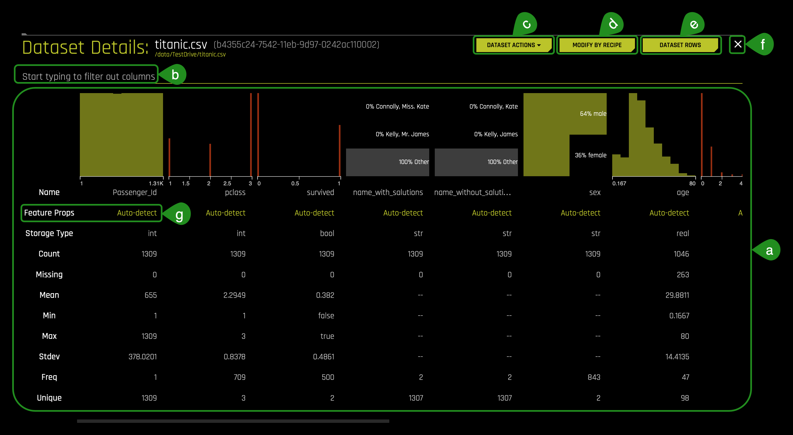

:::info note
**a**. The **Dataset Details Page** provides a summary of the dataset.

View the first 20 rows of a column by hovering over the column name (see image below): 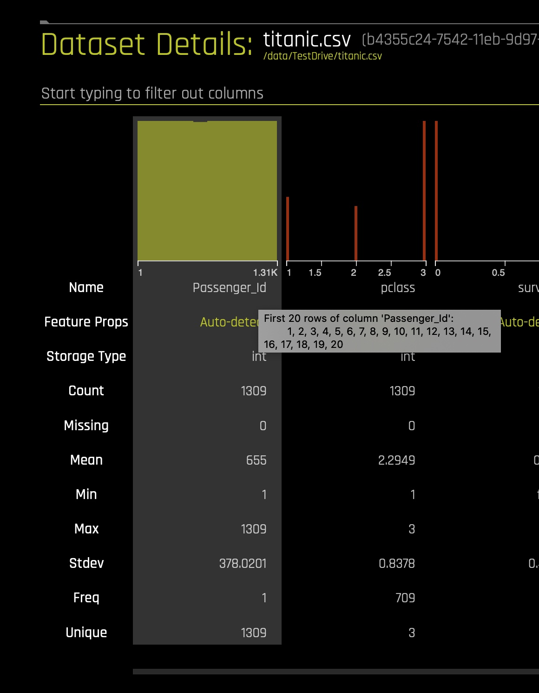
Driverless AI recognizes the following column types: integer, string, real, boolean, and time. Date columns are given a string "str" type. 

**b**. You can view information for a specific column by entering the column's name in the field above the graph.

**c**. The **Dataset Actions** button provides the following options:
- Visualize
- Split
- Predict
- Rename
- Download
- Display Logs
- Delete

**d. Modify by Recipe** allows you to create a new dataset by modifying an existing dataset with custom recipes.

**e. Dataset Rows** allows you to preview the dataset.

**f.** Option to exit and return to the H2O **Datasets** page.

**g. Feature Props**: Allows you to change the column's logical type. If you were to change a given column, you could do so by following these steps:
- Click Auto-detect: 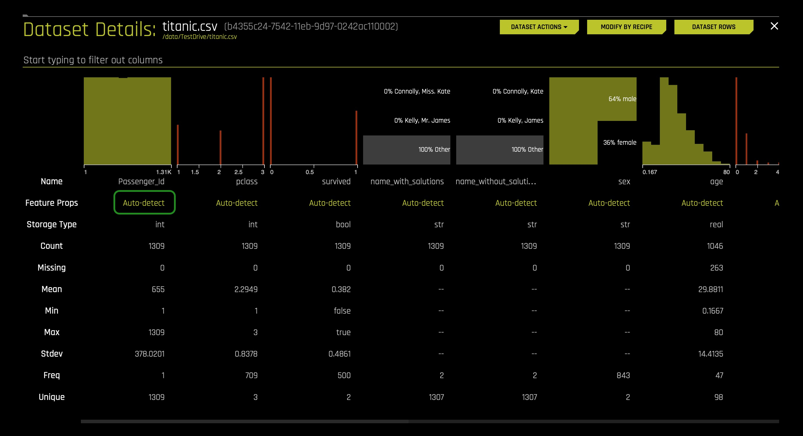
- Click Feature Engineering Type(s): 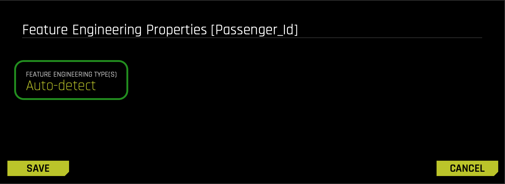
- Select column feature engineering types(b) (then click done at the bottom of page©) or start typing to filter out items(a): 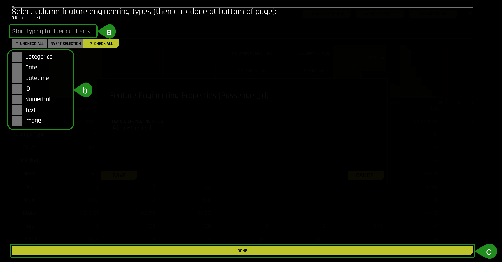

A dataset can only be deleted if it's not being used in an experiment. Otherwise, you must delete the experiment first, and then the dataset.
:::

3. To continue learning about what details are available, click on the following button: Dataset Rows. The following will appear: 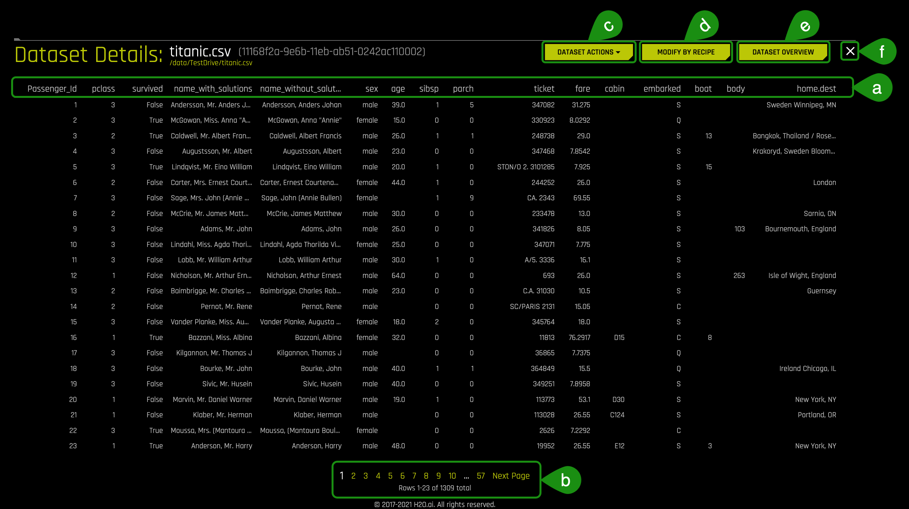

:::info note
**a.** Preview the dataset
**b.** View the remaining rows
**c.** Dataset actions (same options as discussed earlier)
**d.** **Modify by Recipe** - Modify the dataset through a custom recipe or live code (manually enter custom recipe code to use to modify the dataset)
**e.** Return to the **Dataset Overview**
**f.** Option to Exit and return to the H2O **Datasets** page
:::

4. Exit and return to the Datasets page.

### Split the Dataset
From the *Titanic.csv* dataset, we are going to create two datasets, *training and test*. 75% of the data will be used to train the model, and the other 25% will be used to test the trained model.

1. Click on the *titanic.csv* file and select Split: 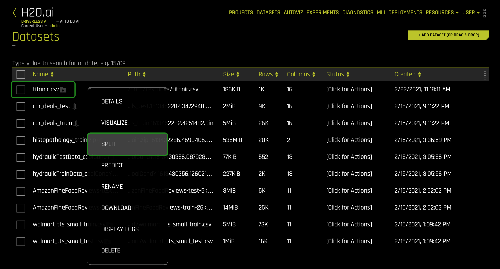
2. Split the data into two sets: `titanic_train` and `titanic_test`, then save the changes. Use the image below as a guide: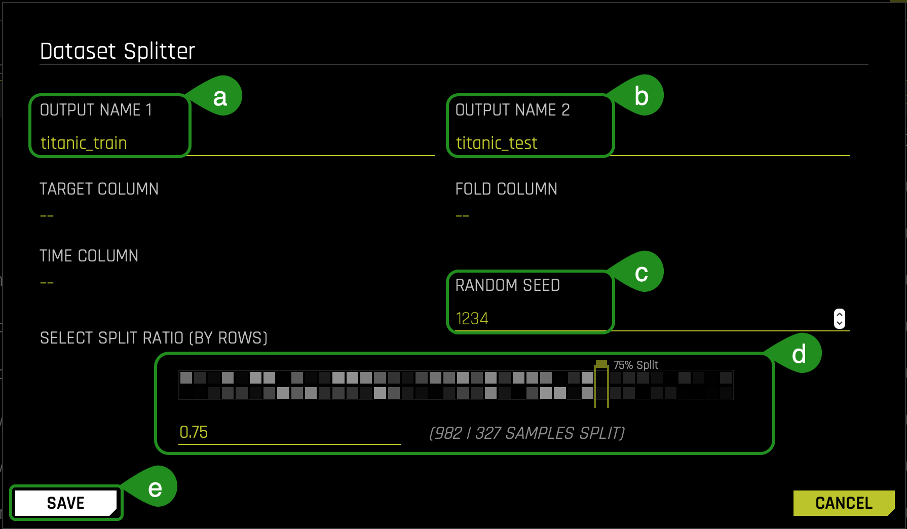

:::info note
**a.** For **OUTPUT NAME 1**: enter `titanic_train` (this will serve as the training set)
**b.** For **OUTPUT NAME 2**: enter `titanic_test` (this will serve as the test set)
**c.** You can change the Random Seed; this will generate the same split every time
**d.** Change the split value to .75 by adjusting the slider to 75% or entering .75 in the section that says *SELECT SPLIT RATIO(BY ROWS)*
**e.** Save the changes you made

The split ratio of .75 (75% for the training set and 25% for the test set) was selected for this particular dataset, not to generalize the model given the set's total size.

- **The training set** contains 981 rows, each row representing a passenger and 16 columns representing each passenger's attributes.
- **The Test set** contains 328 rows, each row representing a passenger and 16 attribute columns representing attributes of each passenger.
:::

3. Verify that the three Titanic datasets, *titanic_test*, *titanic_train*, and *titanic.csv*, are there: 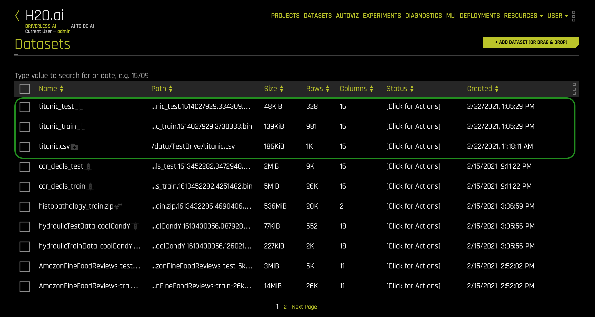

### Autoviz
Now that the *titanic.csv* dataset has been split, we will now use the **titanic_train** dataset. Before we begin our experiment, let's begin by visualizing our dataset while further understanding what features and labels will play a crucial role in our Machine learning model.

There are two ways to visualize the training set: 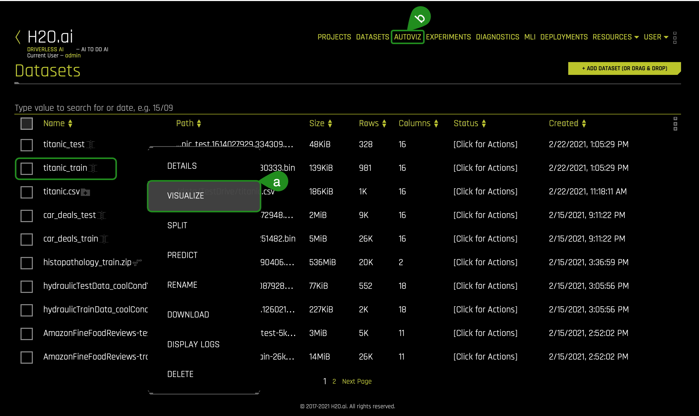

:::info note
**a. Method One**: Clicking on the **titanic_train** file, select **Visualize**, then click on the visualization file generated.
**b. Method Two**: Clicking on the **Autoviz** section(button) inside the section, you will need to click on the **+ NEW VISUALIZATION** button. It will ask you to pick the dataset you want to visualize.

The split ratio of .75 (75% for the training set and 25% for the test set) was selected for this particular dataset, not to generalize the model given the set's total size.

- **The training set** contains 981 rows, each row representing a passenger and 16 columns representing each passenger's attributes.
- **The Test set** contains 328 rows, each row representing a passenger and 16 attribute columns representing attributes of each passenger.
:::

1. Pick a method to visualize the titanic_train dataset. Right after, the following will appear: 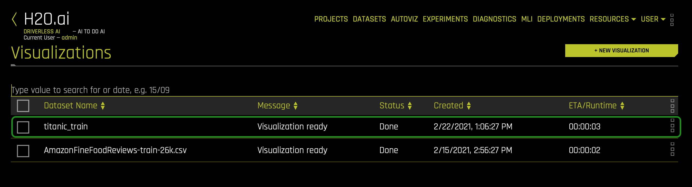
2. Click on the titanic_train visualization, and the following graphs will appear: 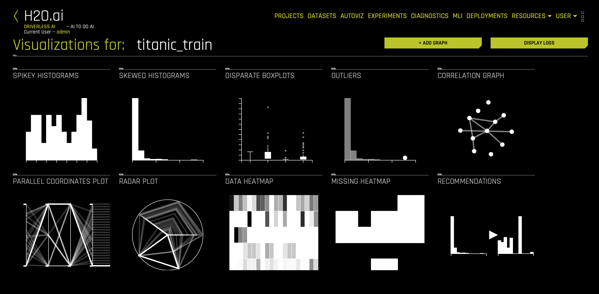

Is it possible to visualize how variables on the training set are correlated? Can we determine what other variables are strongly correlated to a passenger's survival? The answer to those questions is **yes**! One of the graphs that allow us to visualize the correlations between variables is the **Correlation Graph**.

3. Let's explore the correlation between the **survived** variable and other variables in the dataset:
- Select the **Correlation Graph** and then click on **Help** located at the graph's lower-left corner.
- Take a minute to read about how Driverless AI constructed the correlation graph. Learn more about how variables are color-coded to show their correlations.
- Take the ‘survived' variable and drag it slightly to look at the other variables correlated to the **survived** attribute.

What variables are strongly correlated with the ‘survived' variable? Based on the correlation graph, we can see that no correlations were inferred to the **survived** attribute based on the *titanic_train* dataset. Although the graph inferred no correlation, that is not to say that we will not be able to predict whether someone will survive the titanic accident. Visualizing the dataset only gives us an idea/preview of what data will be used to train our model. As well, visualizing can allow for a deeper understanding while highlighting outliers.
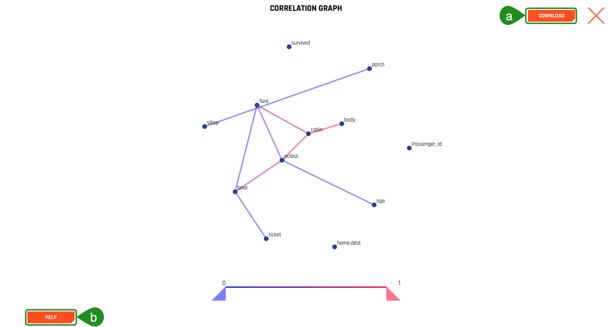

:::info note
**a. Download** allows for a full-scale image of the Graph to be downloaded.
**b.** The Help button explains the Correlation Graph. This feature is available for all graphs.
:::

4. Exit out of the **Correlation Graph** view by clicking on the **X** at the graph's top-right corner.

5. After you are done exploring the other graphs, go back to the **Datasets page**. While exploring, keep in mind that Driverless AI shows graphs that represent "relevant" aspects of the data. The following are the type of graphs available:

- Correlated Scatterplots
- Spikey Histograms
- Skewed Histograms
- Varying Boxplots
- Heteroscedastic Boxplots
- Biplots
- Outliers
- Correlation Graph
- Parallel Coordinates Plot
- Radar Plot
- Data Heatmap
- Missing Values Heatmap
- Gaps Histogram

In the next task, we will proceed to step 3 of our Driverless AI workflow: run an experiment.

### References
Figure 1. RMS Titanic

### Deeper Dive and Resources
- [Learn more about Automatic Visualization from the H2O Driverless AIdocs](http://docs.h2o.ai/driverless-ai/latest-stable/docs/userguide/datasets.html#visualizing-datasets)
- [Learn more about Automatic Visualization from the architect Leland Wilkinson, Chief Scientist, H2O.ai from session at H2O World 2017 Youtube Video](https://www.youtube.com/watch?v=bas3-Ue2qxc)
- [H2O.ai Automatic Visualization by Leland Wikinson (SlideShare)](https://www.slideshare.net/0xdata/automatic-visualization)

## Task 5: Launch First Experiment

We are going to launch our first experiment. An experiment means that we are going to generate a prediction using a dataset of our choice. In this case, we will use the **titanic_train** dataset.

1. Return to the **Datasets Overview** page and click on the **titanic_train** dataset, then select **Predict**: 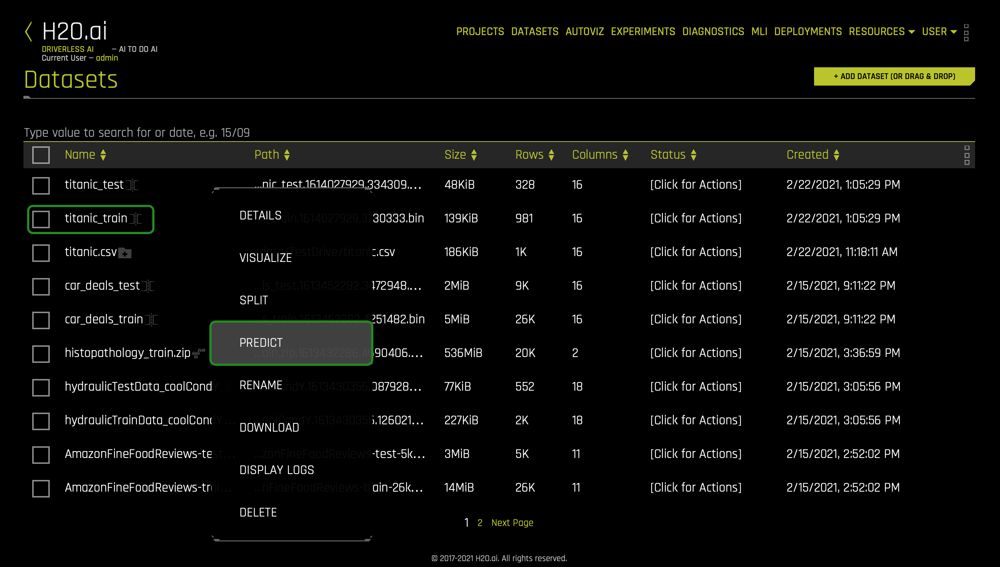

If this is your first time launching an experiment, the following prompt will appear, asking if you want to take a tour:
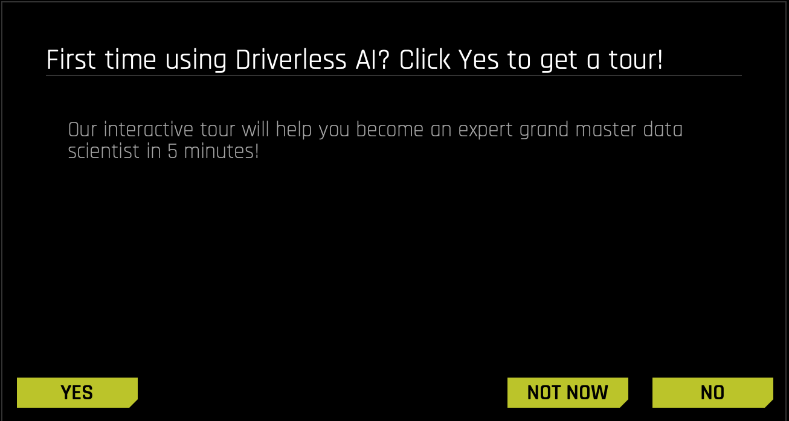

If you would like to take a quick tour of the **Experiments** page, select **YES**; the short tour will cover the following items:

- Selecting a training dataset
- Selecting a target column that you want Driverless AI to predict
- Selecting if it is a Time Series problem or not [Time Series ON or OFF]

2. For the time being, select **Not Now** you can go back later and take a tour. For the most part, this self-paced course will cover what's mentioned during the tour.

3. The **Experiment preview page** will appear; this preview page displays all settings that Driverless AI will use before launching an experiment:
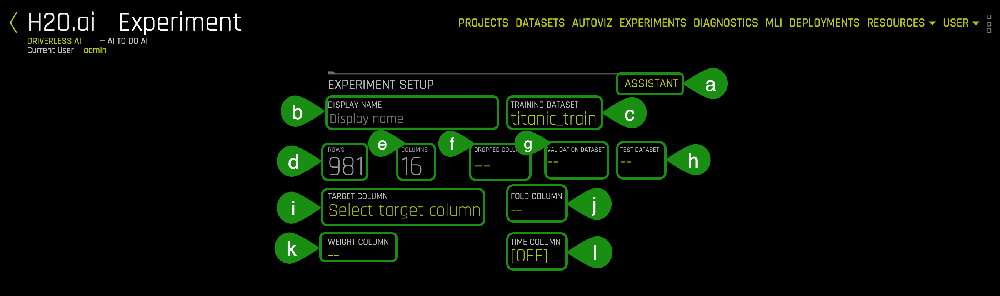

:::info note
**a. Assistant** - Interactive tour for first-time users.
> Click on ASSISTANT to enable it. Yellow circles will appear around sections of the experiment setup page; you can hover over any of them to get more information on each section: 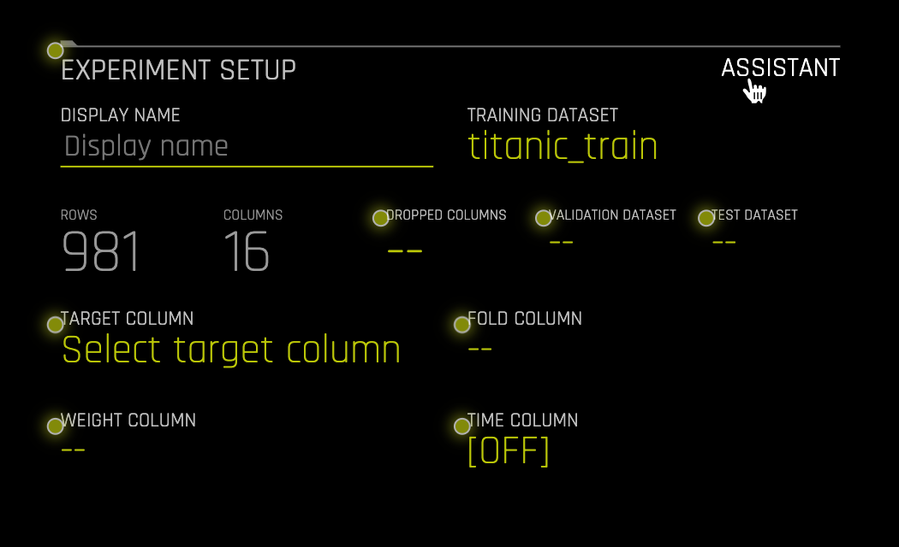
 To disable ASSISTANT, click on assistant again.

**b. Display Name** - Optional: Specify a display name for the new experiment. There are no character or length restrictions for naming. If this field is left blank, Driverless AI will automatically generate a name for the experiment.

**c. Training Dataset** - The name of the Dataset being used to create an experiment

**d. Rows** - Total number of rows

**e. Columns** - Total number of columns

**f. Dropped Columns** - Drop column(s) from your Dataset that you don't want to use in the experiment. For more information, see the H2O.ai documentation [here](http://docs.h2o.ai/driverless-ai/1-8-lts/docs/userguide/experiment-settings.html?highlight=accuracy#dropped-columns)

**g. Validation Dataset** - Select the Dataset you want to validate. This set will be used to validate parameters like models, features, etc. For more information, see the H2O.ai documentation [here](http://docs.h2o.ai/driverless-ai/1-8-lts/docs/userguide/experiment-settings.html?highlight=accuracy#validation-dataset)

**h. Test Dataset** - The Dataset will test the model generated from the training dataset. It's not used during the model's training, and results are available at the end of the experiment. For more information, see the H2O.ai documentation [here](http://docs.h2o.ai/driverless-ai/1-8-lts/docs/userguide/experiment-settings.html?highlight=accuracy#test-dataset)

**i. Target Column** - The column that will be used to predict furthermore is the piece of data you want to understand. When selecting a target column, ask yourself what you want to predict

**j. Fold Column** - The fold column is used to create the training and validation datasets so that all rows with the same fold value will be in the same Dataset. This column will be used if no validation dataset is provided and the model is trained using cross-validation. For more information, see the H2O.ai documentation [here](http://docs.h2o.ai/driverless-ai/1-8-lts/docs/userguide/experiment-settings.html?highlight=accuracy#fold-column)

**k. Weight Column** - Column that indicates the observation/instance weight (a.k.a. sample or row weight), if applicable. For more information see the H2O.ai documentation [here](http://docs.h2o.ai/driverless-ai/1-8-lts/docs/userguide/experiment-settings.html?highlight=accuracy#weight-column)

**l. Time Column**(OFF by default) - Provides a time order(timestamps for observations). When data has a high dependency on time (such as seasonality or trend), you want to treat this problem as a time series problem. For more information, see the H2O.ai documentation [here](http://docs.h2o.ai/driverless-ai/1-8-lts/docs/userguide/experiment-settings.html?highlight=accuracy#time-column)
:::

4. Continuing with our experiment, name your experiment as follows: `Titanic Classification Tutorial`

5. Click **Dropped Columns**, drop the following columns, then select **Done**:

- **Passenger_Id**
- **name_with_salutations**
- **name_without_salutations**
- **boat**
- **body**
- **home.dest**

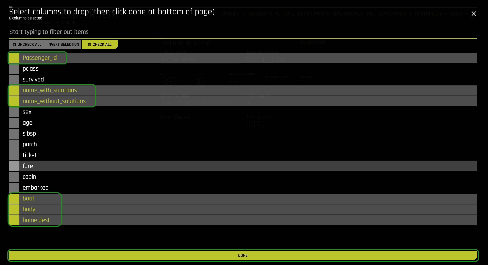

We removed these attributes (columns) to create a cleaner dataset. Attributes such as **boat** and **body** are excluded because they are clear indicators that a passenger survived and can lead to data leakage. A clean dataset is essential for the creation of a good predictive model. The process of data cleansing needs to be done with all datasets to rid the set of any unwanted observations, structural errors, unwanted outliers, or missing data.

6. For our experiment, we will be using a test dataset. To select the test dataset, select **TEST DATASET** and select the **titanic_test**:
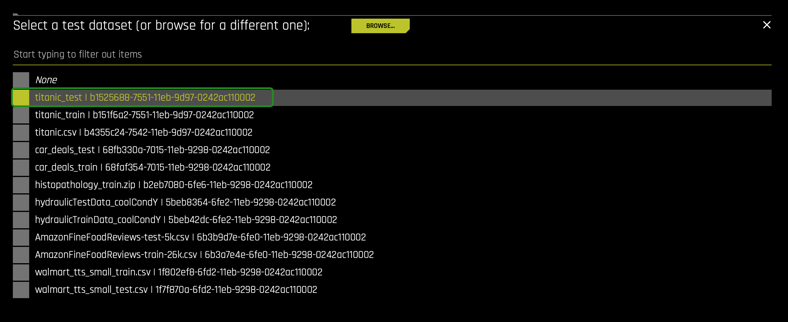

7. Now, select the TARGET COLUMN. In our case, the column will be survived. We want to know who will be surviving base on the information the model will be trained on (e.g., age): 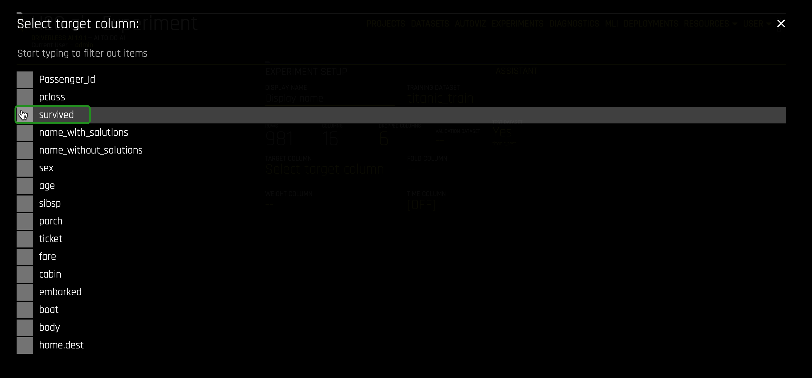

The *survived* attribute was selected because, as an insurance company, we want to know what attributes can contribute to passengers' survival. Knowing these attributes from the perspective of an insurance company can be beneficial because it can give the insurance company a good idea of how to manage the rate of insurances.

8. Your experiment page should look similar to the one below; these are the system suggestions based on the data selected to train this model: 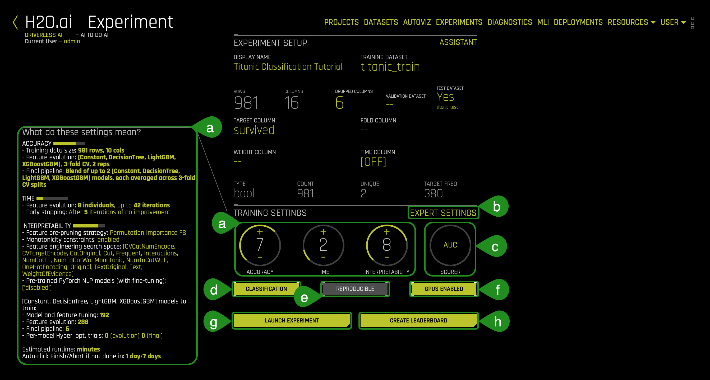

:::info note
- 
    **a.** **Training Settings** - Describes your specific experiment's Accuracy, Time, and Interpretability. The knobs on the experiment settings are adjustable as values change the settings' meaning on the left-bottom page change.
    - **Accuracy** - As accuracy increases, Driverless AI gradually adjusts the method for performing the evolution and ensemble. At low accuracy, Driverless AI varies features and models, but they all compete evenly against each other. At higher accuracy, each independent main model will evolve independently and be part of the final ensemble as an ensemble over different main models. At higher accuracies, Driverless AI will evolve+ensemble feature types like Target Encoding on and off that evolve independently. Finally, at highest accuracies, Driverless AI performs both model and feature tracking and ensembles all those variations. Changing this value affects the feature evolution and final pipeline.
        * **Note:** A check for a shift in the distribution between train and test is done for accuracy >= 5.
        * **Feature evolution:** This represents the algorithms used to create the experiment. If a test set is provided without a validation set, then Driverless AI will perform a 1/3 validation split during the experiment. If a validation set is provided, then the experiment will perform external validation.
        * **Final pipeline**: This represents the number of models and the validation method used in the final pipeline. For ensemble modeling, information about how models are combined is also shown here
        * For more information about Accuracy see the H2O.ai documentation [here](http://docs.h2o.ai/driverless-ai/latest-stable/docs/userguide/experiment-settings.html?highlight=accuracy%20setting#accuracy).

:::